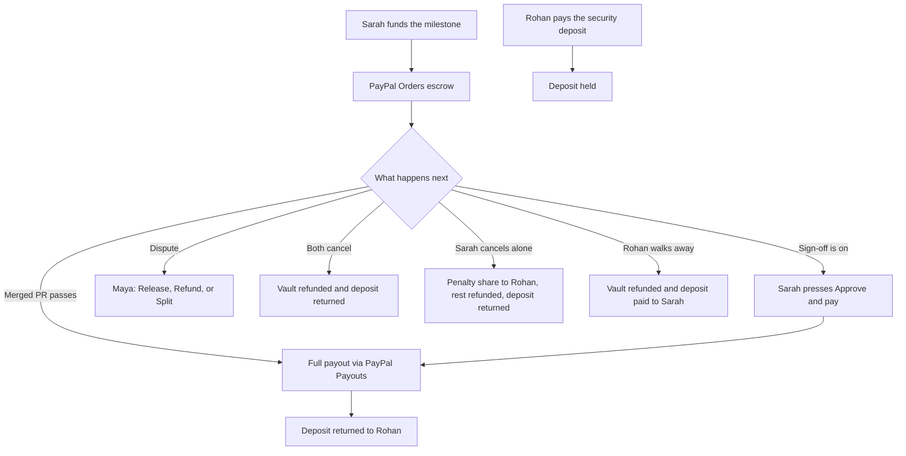

# Aegis-Split

PayPal Hackathon 2026 · Team Escrow eSports — Mayank Kumar Agarwal, Kavya Chavda, Abhiraj Chhaparwal, Mohit Khoiwal, Krishna Chaudhari

**Live demo:** [https://aegis-split.onrender.com](https://aegis-split.onrender.com)

Aegis-Split holds a freelance milestone in PayPal until a merged pull request meets the locked criteria, then pays the freelancer in full. Platform fee: 0%.

## The problem

A client can disappear after the work lands. A freelancer can disappear after the client has paid. The scope can change after both sides agreed the words. A platform fee and an opaque dispute make that worse.

## How Aegis-Split solves it

Sarah funds one milestone with PayPal. That capture stays in escrow. Rohan pays a security deposit (10% of the milestone by default). The acceptance criteria are saved with the milestone. A merged GitHub pull request is checked against those words. Objective work that passes is paid in full through PayPal Payouts. Subjective work can wait until Sarah presses **Approve and pay**. If they disagree, either person raises a dispute and Maya (the counselor) releases, refunds, or splits the escrow. Leaving early follows the rules below. Aegis-Split takes no fee.

## Judge demo

Open the [live demo](https://aegis-split.onrender.com). Follow the **Next:** line on each screen. The top rail is Home, People, Verify, Project, Fund, Work, Paid, Exit, Counselor, Agency.

1. **Start demo.** Press **Start demo**. That loads Sarah Chen (client), Rohan Mehta (freelancer), and Maya Rao (counselor), and selects Sarah. Press **Sarah Chen**.
2. **Verify and sign.** Press **Quick verify (judges)**. Tick the agreement (the name and date are filled in). Press **Sign agreement**, then **Continue to the project**.
3. **Create the project.** Leave the sample (Auth service MVP, $250). Press **Create project**, then **Continue to funding**. Leave **Needs manual client sign-off** off, under **More options**, so a passing check pays immediately.
4. **Fund escrow, then the deposit.** Press **Fund escrow**. On the live site, press **Open PayPal to approve** and finish the PayPal sandbox checkout. The deposit button belongs to Rohan. Press **Switch**, choose **Rohan Mehta**, open **Fund**, and press **Pay security deposit** (then **Open PayPal to approve the deposit**). Press **Continue to work**. The sample milestone is $250, so the default deposit is $25.
5. **Submit work.** Leave repo `demo/aegis-auth` and PR `1`. Press **Submit work**. That links the pull request and runs the check. Press **See payout**.
6. **Paid.** The screen shows the full milestone. Aegis-Split takes no fee. A held deposit is returned to Rohan when the milestone is paid.

On a local mock with no PayPal buyer, open **More** on Fund and turn on **Capture immediately (local demo only)** before the two payment buttons.

**Full DigiLocker sandbox.** On Verify, open **Show full DigiLocker flow**. The sandbox code is already `123456` for email, phone, and government ID. Sarah’s sandbox demo ID is `234567890124` (the form fills it in; it is a checksum demo number). Press **Verify email**, **Verify phone**, then **Verify government ID**. The flow stays inside this app. Stripe Identity is marked coming soon.

**Optional dispute.** On Project, open **Raise a dispute** and press **Raise dispute**. Payout and exit wait until Maya decides. Press **Switch**, choose **Maya Rao**, and open **Counselor**. The case includes the chat, the audit, the diff, and **Call recording (preview - sample)** (sample audio and a transcript). Choose **Release to freelancer**, **Refund client**, or **Split**, write a short note, and press **Confirm decision**. The first press shows the money. The second press sends it.

**Optional agency.** Open **Agency** and press **Load demo agency**. Sample rows are marked Sample. A Sarah and Rohan project is marked Live. This screen does not move money. White-label is marked coming soon.

## Features

| Feature | Status |
| --- | --- |
| PayPal Orders escrow for each milestone | Live (sandbox) |
| PayPal Payouts for the full milestone, 0% platform fee | Live (sandbox) |
| Freelancer security deposit, default 10% | Live (sandbox) |
| Early exit: mutual cancel, client penalty (default 50%), freelancer walk-away | Live (sandbox) |
| Optional client sign-off before payout | Live (sandbox) |
| Merged-PR check against locked criteria (model if a key is set, otherwise a keyword check) | Live (sandbox) |
| Project text chat and in-app alerts (fund, audit, pay, exit, deposit, dispute) | Live (sandbox) |
| Counselor panel: Release, Refund, or Split (Maya is a seeded demo user) | Live (sandbox) |
| DigiLocker-style sandbox KYC, Quick verify, and signed consent | Demo preview |
| Agency dashboard (Escrow eSports Studio, read only) | Demo preview |
| Call recording (preview - sample) | Demo preview |
| Multi-sig vault | Roadmap |
| Live DigiLocker and Stripe Identity | Roadmap |
| Agora calls, Whisper transcripts, and S3 storage | Roadmap |
| White-label and multi-seat billing | Roadmap |
| Off-platform chat detection and a legal workflow | Roadmap |
| Real login (the demo sends `X-User-Id`) | Roadmap |

## How money moves

Amounts are integer cents. Percentages use floor, so a split never invents a cent.

- **Escrow.** **Fund escrow** creates a PayPal order for the milestone. After Sarah approves, the return URL captures it.
- **Deposit.** **Pay security deposit** is a second PayPal order. The default is 10% of the milestone total (`$250` → `$25`). It stays held until the milestone is paid, the project exits, or Maya decides a dispute.
- **Payout.** A passing check on an objective milestone pays the full amount to Rohan and returns the deposit. With sign-off on, the milestone waits until Sarah presses **Approve and pay**. A failed check does not pay.
- **Dispute.** Release pays the remaining vault to Rohan. Refund sends it back to Sarah. Split pays Rohan the chosen percent (default 50%) and refunds the rest. The deposit returns to Rohan unless **Freelancer at fault** is checked, which forfeits it to Sarah.
- **Early exit.** From Paid, open **Cancel or exit**, press **Preview exit**, then **Confirm**.

| Who leaves | Unspent escrow | Deposit |
| --- | --- | --- |
| Both agree | 100% back to Sarah | Returned to Rohan |
| Sarah cancels alone | Default 50% to Rohan; the rest back to Sarah | Returned to Rohan |
| Rohan walks away | 100% back to Sarah | Forfeited to Sarah |



A local mock simulates order ids, payouts, and refunds. On PayPal sandbox, a refund succeeds only while PayPal still allows that capture to be refunded.

## Tech stack

The browser demo and the API are one Node.js process. Express serves `public/` and `/api`. Prisma stores projects, escrow, deposits, audits, chat, and disputes in PostgreSQL. The live site uses Neon. Money calls use PayPal Orders v2, Payouts, and capture refunds. **Submit work** links the sample repo, then runs a demo merge whose diff includes the acceptance criteria so the keyword check can pass without a public GitHub URL. A real `pull_request` webhook checks `X-Hub-Signature-256` when `GITHUB_WEBHOOK_SECRET` is set.

The auditor calls GPT-4o mini when `OPENAI_API_KEY` is set, otherwise Claude 3.5 Haiku when `ANTHROPIC_API_KEY` is set, otherwise a keyword check of the diff. The Render blueprint selects the keyword check. Picking a person sets the `X-User-Id` header. Real login is on the roadmap.

## Run locally

Prerequisites: Node.js 18 or newer, npm, and PostgreSQL.

```bash
cp .env.example .env
npm install
npx prisma migrate dev
npm start
```

Open [http://localhost:3000](http://localhost:3000).

`npx prisma migrate deploy` is what the Docker image runs against an existing database. `npm run dev` restarts on file changes. `npm test` runs the unit tests.

### Environment variables

Names only. Copy `.env.example` and fill values there. Do not commit secrets.

- **Required:** `DATABASE_URL`
- **Server:** `PORT`, `NODE_ENV`, `APP_BASE_URL`
- **PayPal:** `PAYPAL_CLIENT_ID`, `PAYPAL_CLIENT_SECRET`, `PAYPAL_MODE`, `PAYPAL_MOCK`, `PAYPAL_AUTO_CAPTURE`, `PAYPAL_RETURN_URL`, `PAYPAL_CANCEL_URL`, `PAYPAL_BUYER_EMAIL`, `PAYPAL_PAYOUT_EMAIL`, `PAYPAL_WEBHOOK_ID`
- **Demo and auditor:** `DEMO_ADMIN_KEY`, `AI_AUDITOR_PROVIDER`, `OPENAI_API_KEY`, `OPENAI_MODEL`, `ANTHROPIC_API_KEY`, `ANTHROPIC_MODEL`, `AI_AUDITOR_STRICT`
- **GitHub:** `GITHUB_WEBHOOK_SECRET`, `GITHUB_TOKEN`, `GITHUB_API_BASE_URL`, `GITHUB_APP_ID`, `GITHUB_APP_PRIVATE_KEY`, `GITHUB_APP_INSTALLATION_ID`
- **Identity placeholders for a future live integration:** `DIGILOCKER_CLIENT_ID`, `DIGILOCKER_CLIENT_SECRET`, `DIGILOCKER_AUTH_URL`, `DIGILOCKER_TOKEN_URL`, `DIGILOCKER_REDIRECT_URI`, `STRIPE_SECRET_KEY`, `STRIPE_IDENTITY_RETURN_URL`
- **Other:** `MONITORING_CONSENT_VERSION`, `DEFAULT_MILESTONE_CURRENCY`

When `APP_BASE_URL` is empty, the app can use `RENDER_EXTERNAL_URL`, `RENDER_EXTERNAL_HOSTNAME`, `RAILWAY_PUBLIC_DOMAIN`, or `FLY_APP_NAME`.

Leave `PAYPAL_MOCK` on for a local run without sandbox keys. Turn it off and set the sandbox client id and secret to call PayPal. Leave `PAYPAL_AUTO_CAPTURE` off for approve-then-capture. `PAYPAL_WEBHOOK_ID` is only for inbound PayPal webhooks. The approve → return → capture path works without it.

### Deploy on Render

The public demo is [https://aegis-split.onrender.com](https://aegis-split.onrender.com): a Render Docker web service, Neon Postgres, and PayPal sandbox.

- Blueprint file: `render.yaml`. Health check: `GET /health` (reports PayPal mock mode, and no secrets).
- On boot, `scripts/docker-entrypoint.sh` runs `prisma migrate deploy`, then starts the server.
- Set `DATABASE_URL` in the Render dashboard. PayPal client id, secret, `PAYPAL_MOCK`, and `PAYPAL_AUTO_CAPTURE` are dashboard-owned (`sync: false`), so a blueprint sync leaves a live sandbox setup in place.
- The blueprint sets `PAYPAL_MODE` to sandbox.

[](https://dashboard.render.com/blueprints/new?repo=https://github.com/abhii176/AEGIS-SPILT)

Railway and Fly.io notes are in [DEPLOY.md](./DEPLOY.md).

## Powered by PayPal

PayPal is the money rail for escrow, deposits, payouts, and refunds.

- **Orders** lock the client’s milestone and the freelancer’s security deposit.
- **Payouts** pay the freelancer, pay an early-exit penalty, return a deposit, or send a forfeited deposit to the client.
- **Capture refunds** send unspent escrow back to the client.

The public demo is the PayPal sandbox deployment. Locally, the app returns simulated ids when `PAYPAL_MOCK` is on, and also when that flag is unset and the client id or secret is still a placeholder.
